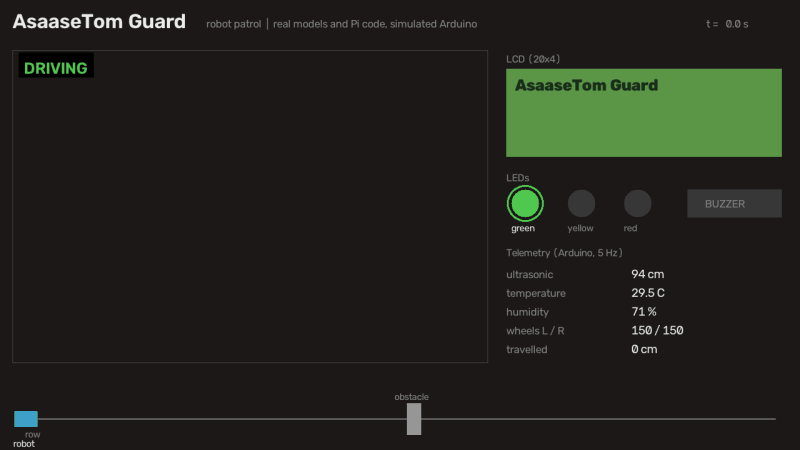

# AsaaseTom Guard: tomato disease detection robot

**1st place, JHS category, RAIL Phase II Robotics Cohort II Challenge, KNUST, January 2026**
([KNUST news](https://www.knust.edu.gh/index.php/news/news-items/st-louis-shs-opoku-ware-ma-jhs-win-rail-phase-ii-robotics-challenge),
[GES Kumasi Metro](https://web.facebook.com/GesKumasiMetro/posts/opoku-ware-ma-jhs-robotics-team-wins-with-smart-crop-disease-detection-systemthe/1474798337981988/)).
Built in 2025 with the Opoku Ware M/A JHS robotics team, which I trained and mentored.

A robot that drives along tomato rows, photographs leaves and fruit, detects disease
with two YOLOv8 models and warns the farmer on the spot with LEDs, a buzzer and an LCD,
while every inspection is logged to a dashboard.



*A patrol rendered by `tools/render_demo.py`: the real models and Pi code, with the simulated
Arduino. The robot inspects eight plants, stops for an obstacle, waits, and resumes when it is
taken away. The photos were chosen to show each alert level and two known failures: plant 5 is a
false alarm (the leaf model reads "Early Blight" on a fruit) and plant 3 is a miss (visible mold,
reported OK).*

## How it works

```
camera image ──> leaf detector (9 classes) ──┐
             └─> fruit detector (8 classes) ─┴─> alert level ──> LEDs, buzzer, LCD
                                                      └─────────> JSON log + annotated image ──> Streamlit dashboard
```

| Alert | When | Robot output |
|---|---|---|
| 🟢 OK | nothing found, or only healthy plants | green LED |
| 🟡 CHECK | a disease below the alert threshold (default 0.5) | yellow LED, disease name on the LCD |
| 🔴 DISEASE | a disease at or above the alert threshold | red LED, buzzer, disease name on the LCD |

At the competition this ran on a Raspberry Pi with a camera, on a four-wheel-drive chassis,
with an Arduino handling the sensors and the outputs, motor drivers included. The robot
stayed with the school and the original on-robot code was not kept, so I rebuilt the robot
software in October 2026; see [Robot software](#robot-software-rebuilt-october-2026).

## Robot software (rebuilt October 2026)

**Verification:** the Pi side is tested end to end against a simulated Arduino, and CI
compiles the firmware for the Uno on every push.

```
 Raspberry Pi 4 (Python, robot/)                    Arduino Uno + L293D shield (C++, firmware/)
 ───────────────────────────────                    ───────────────────────────────────────────
 Pi camera ─> YOLO leaf/fruit ─> alert level        4 DC motors, HC-SR04, DHT22, LEDs,
 patrol: drive ─> stop ─> settle ─> inspect   UART  active buzzer, 20x4 I2C LCD
         obstacle: wait, retry, give up    ◀──────▶ runs commands, streams telemetry at 5 Hz
 heartbeat ping while driving                       safety reflexes that need no Pi:
                                                      · each drive stops by itself
                                                      · no message for 1 s: stop
                                                      · obstacle under 20 cm: stop
```

- **Protocol** (`robot/protocol.py`): one ASCII line per message with an NMEA-style XOR checksum,
  so a corrupted line is dropped instead of executed. Every command is acknowledged; the Pi
  retries lost ones, and every command is safe to repeat.
- **Safety in the firmware, not the Pi**: if the Pi hangs mid-inference or a wire comes loose,
  the Arduino stops the wheels by itself.
- **Simulation** (`robot/sim_arduino.py`): a Python twin of the firmware with the same rules,
  a robot position along the row and an optional obstacle. The tests drive the real Pi code
  against it: lost commands, corrupted lines, the watchdog, the obstacle reflex, and a patrol
  that waits for an obstacle, retries, and either resumes or ends the row.

```bash
python run_robot.py --sim                     # simulated Arduino, photos from test_images/
python run_robot.py --sim --obstacle-cm 150   # obstacle 1.5 m down the row: the row ends "blocked"
python run_robot.py --port /dev/serial0       # on the robot
```

### Wiring

| Arduino Uno | Connected to |
|---|---|
| L293D shield, M1 to M4 | front-left, rear-left, rear-right, front-right motors |
| D0 (RX) | Pi GPIO14 (TXD) |
| D1 (TX) | Pi GPIO15 (RXD) **through a 1 kΩ / 2 kΩ divider**: the Uno sends 5 V, the Pi takes 3.3 V |
| GND | Pi GND (common ground is required) |
| A0 / A1 | HC-SR04 trigger / echo |
| D2 | DHT22 data |
| A2, A3, D13 | red, yellow, green LEDs (with resistors) |
| D9 | active buzzer (not `tone()`: it uses Timer2, which drives motor PWM on D3 and D11) |
| A4 / A5 | LCD I2C SDA / SCL, address 0x27 |

On the Pi, enable the UART and disable the serial login console (`sudo raspi-config`, Interface
Options, Serial Port), then `pip install -r requirements-robot.txt`. Unplug D0/D1 while uploading
the sketch, since they share the USB serial port.

## Models

Two YOLOv8n detectors, fine-tuned from the COCO-pretrained `yolov8n.pt` for 30 epochs
at 640 px on a Colab GPU (Ultralytics 8.3.229). Figures are on each dataset's
validation split, read from the checkpoints' training records.

| Model | Classes | mAP50 | mAP50-95 | Precision | Recall |
|---|---|---|---|---|---|
| Leaf (`models/leaf_best.pt`) | 9: Early Blight, Late Blight, Leaf Miner, Leaf Mold, Mosaic Virus, Septoria, Spider Mites, Yellow Leaf Curl Virus, Healthy | 0.931 | 0.829 | 0.873 | 0.881 |
| Fruit (`models/fruit_best.pt`) | 8: Anthracnose, Blossom End Rot, Catfaced, Fruit Cracking, Late Blight, Mold, Spotted Wilt Virus, Healthy | 0.760 | 0.419 | 0.791 | 0.718 |

Datasets (both CC BY 4.0, Roboflow Universe):
[tomato leaf diseases](https://universe.roboflow.com/kampem/tomato-leaf-diseases-4xa5i-5cg52/dataset/1) and
[tomato fruit diseases](https://universe.roboflow.com/tomato-fruit-diseases/tomato-fruit-diseases-detection/dataset/3).

## Run it

```bash
pip install -r requirements.txt
python main.py                       # both detectors on test_images/
python main.py --models leaf         # leaf detector only
python main.py --alert-threshold 0.6 # stricter alarm
streamlit run app.py                 # dashboard over data/logs/
python tools/render_demo.py          # render the patrol video: docs/demo.mp4 and docs/demo.gif
```

## Tests

```bash
pip install pytest
pytest            # protocol, robot link and patrol, alert logic, logging; model tests too when ultralytics is installed
```

CI runs the tests and compiles the firmware for the Uno on every push.

## Limitations

- Metrics are validation-split figures; there is no separate held-out test run yet.
- The fruit model finds diseased regions better than it outlines them (mAP50 0.76 against mAP50-95 0.42).
- Both detectors run on every image, because the pipeline cannot yet tell a leaf photo from a fruit photo,
  and the leaf model misfires on fruit: on the 43 test images it fired on 14 of the 19 fruit photos
  (once "Early Blight" at 91%) and changed the alert on 4 of them. The fruit model fired on 4 of the 24 leaf
  photos without changing any alert. Suppressing overlapping boxes across the two models halved the
  wrong-model boxes but changed no alerts, so it was not adopted. Use `--models` when you know which one
  you are looking at; the real fix is a leaf-or-fruit decision before detection.
